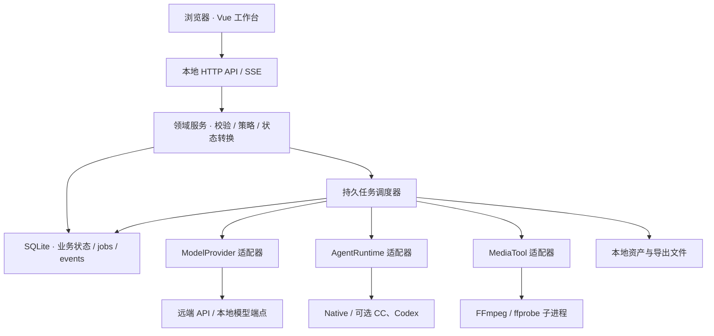
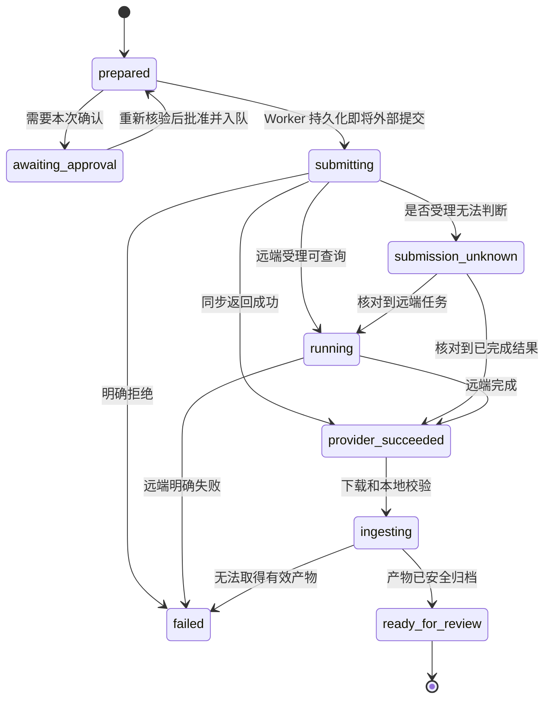

# OwnTake 技术架构

> 设计基线 v0.1 · 更新于 2026-11-07。本文约定正式应用的边界、数据和执行语义；P1–P5 已有实现，各阶段交付范围和验证限制见 `docs/validation/`。HTTP 层现使用 Fastify，具体迁移记录见 [Fastify 说明](validation/fastify.md)。`docs/prototype/` 仍是独立的静态交互演示。
>
> 配套阅读：[产品设计](product-design.md) · [实施计划](implementation-plan.md) · [资料与设计依据](sources.md)。本文中的具体库版本、模型 ID、价格及账户能力，需要在实施对应阶段核验并锁定。

## 1. 架构结论与适用范围

**本地 Web 使用 Vue 3 + TypeScript + Vite 界面，Node.js + TypeScript + Fastify 本地服务，SQLite 存业务状态，本地目录存媒体，FFmpeg / ffprobe 处理媒体。** 浏览器只负责交互；后台任务、外部 API、凭据、文件和子进程由本地服务管理。

| 决策 | 原因与边界 |
| --- | --- |
| 单人、单机，先支持 macOS | 不建立用户账户、团队权限、租户、商业计费和云同步系统 |
| 一个 Node 服务进程，必要时启动子进程 | 避免为个人工具维护分布式服务；媒体处理不能阻塞请求处理线程 |
| SQLite 持久任务 + 小型进程内调度器 | 数据库是恢复依据，内存只负责唤醒；不引入 Redis、BullMQ、Temporal |
| 本地资产目录 + 不可变版本 | 原文件、候选与导出可追溯；不引入 S3 或对象存储服务 |
| 模型、Agent Runtime、媒体工具分别适配 | 模型接口与具备工具循环、权限和会话的运行时职责不同 |
| 先实现 Native 有界任务执行器 | P2 接入规划能力；Claude Code / Codex 作为 P4 可选运行时 |
| Electron 留到 P5 | 本地 Web 已能独立使用，桌面壳仅改善启动和系统集成 |

本地运行不等于所有推理都离线。连接远端模型时，选中的提示词和参考素材需要传给对应服务；本地模型端点也必须满足相同的能力合同。运行位置与模型能力分别配置。

Node 的异步子进程、SQLite 的本地使用与 WAL 限制、FFmpeg 能力及 Agent Runtime 接入依据见 [官方资料](sources.md)。本方案选择低并发和单机部署，是产品范围带来的工程取舍。

## 2. 进程、模块与调用方向



前端不能直接访问供应商、读取 API Key、操作 SQLite 或启动命令。运行时与模型输出只能提出结构化建议；真正的文件修改、付费调用和版本选择仍经过领域服务及项目策略。

开发时 Vite 将 `/api` 和事件流代理到本地服务，生产构建由 Node 服务提供静态文件，尽量保持浏览器同源访问。默认仅监听 `127.0.0.1`。服务启动不依赖浏览器连接，刷新、关闭标签页或 SSE 断开都不表示取消任务。

### 当前代码结构与依赖方向

HTTP 适配、应用用例和资源所有权分别组织；既有 Repository 与 Runner 保持独立，沿用持久化与恢复合同：

```text
apps/
  web/src/                  Vue 页面、组件、状态与 API 客户端
  desktop/src/              Electron 主进程、受限桥接、核心子进程入口
  server/src/
    app.ts                  Fastify 应用装配、buildApp 与 startServer
    http/routes/            按业务模块组织的路由、媒体、SSE
    http/schemas/           TypeBox 请求 Schema 与错误码映射
    http/plugins/           来源、会话、CSRF、安全头、错误与文件传输
    application/            用例与事务边界
    bootstrap/              数据目录、SQLite、Runner 的资源所有权
    config/                 服务配置与 HTTP / 会话 / 媒体 / 时间线策略
    *-repository.ts         业务持久化与领域规则协调
    *-runner.ts             持久任务执行、恢复与取消
    scheduler.ts            本地导出任务调度
packages/
  contracts/                DTO、运行时 Schema、错误码、事件合同
  domain/                   状态机、依赖失效、策略与纯函数
  storage/                  SQLite、迁移、事务、资产仓库
  providers/                模型适配器与能力清单
  runtimes/                 Native 与可选外部运行时
  media/                    ffprobe、Timeline 编译、FFmpeg 执行
docs/                       产品、架构、阶段与原型
```

Fastify 与插件版本由 lockfile 锁定；SQLite 使用 Node 内置驱动。HTTP 路由负责请求 Schema、状态码和响应头，复合操作交给 `application/`。应用用例接收普通参数与按需收窄的资源依赖，不引用 Fastify 请求 / 响应类型；领域校验保持纯函数。HTTP Schema 检查数据形状，领域层继续校验版本、预算、资产归属及状态转换。

`buildApp()` 创建可注入请求的应用，不监听端口、不启动后台任务；`startServer()` 在监听成功后启动恢复与调度。`bootstrap/core.ts` 独占数据库和实例锁，统一管理 Runner 停止与释放。HTTP 关闭时结束 SSE、取消上传，并等待上传清理及已开始的异步处理函数完成，最后释放数据库和锁；启动失败与重复关闭走同一释放路径。Web 和 Electron 使用同一个入口。

可以采用 `reduce(state, event) -> { nextState, commands }` 组织关键状态转换：纯函数决定结果，应用服务在事务内保存状态与待执行命令，调度器在事务外执行 I/O。这里不建设完整事件溯源平台；SQLite 当前业务记录是权威状态，`events` 用于通知与审计。

## 3. 本地存储与数据所有权

### 3.1 默认目录

```text
~/Library/Application Support/OwnTake/
  app.sqlite                项目、任务、版本、事件与费用记录
  config.json               非敏感运行配置
  credentials.json          MVP 可选凭据文件，目录 0700 / 文件 0600
  logs/                     脱敏、轮换的服务日志
  backups/                  数据库一致性备份

~/Movies/OwnTake/Projects/<project-id>/
  project.owntake.json       项目标识与目录格式版本，不覆盖数据库业务状态
  assets/<artifact-id>/      不可变原始文件及衍生物
  exports/<export-id>/       完整导出和对应渲染清单
  .work/<job-id>/<run-id>/    下载、探测和渲染临时文件
```

项目根目录可以在受控配置中更改。P1 Web 界面通过上传接口导入文件；不要假定普通网页能取得用户文件的真实本地路径或调用原生文件夹选择器。桌面文件夹选择留到 P5。

活动数据库放本地磁盘，不作为网络盘或云盘中的共享活动文件。项目文件与数据库分离，因此只复制某个媒体目录不等于完整备份项目；完整备份必须同时包含一致性数据库快照与其引用的媒体。P1 即提供并验证一套备份 / 恢复步骤，可以采用命令或脚本，覆盖数据库与已有媒体；P3 随新增生成记录扩展恢复验收，P4 再按需要完善打包界面。

### 3.2 数据对象

| 表 / 对象 | 必要字段与职责 | 关键不变量 |
| --- | --- | --- |
| `projects` | `id`、名称、根目录登记、`brief_json`、`style_bible_json`、项目策略、活动时间线 ID、版本号 | Brief 和 StyleBible 是项目文档；修改后只使相关依赖失效 |
| `shots` | 稳定 `id`、项目 ID、排序、当前 `shot_revision_id`、选中的 `artifact_id` | 镜头身份不随改稿改变；选中素材只由明确操作修改 |
| `shot_revisions` | 镜头 ID、递增版本、画面 / 文本 / 音频 / 剪辑意图 JSON、各依赖摘要 | 已创建版本不可改写；字幕修改不必改变画面摘要 |
| `generation_intents` | `operation_id`、`client_request_id`、输入指纹、项目 / 镜头目标版本、冻结计划、状态 | 同一次模型调用只创建一个意图；改模型或重新抽卡创建新意图 |
| `provider_attempts` | 意图 ID、供应商连接与模型快照、幂等键、远端任务 ID、状态、查询记录 | 代表一次远端生成生命周期，网络重试次数另记；不能每次超时就新建付费尝试 |
| `artifacts` | 不可变 ID、项目 ID、类型、来源、相对路径、内容摘要、大小、媒体元数据、输入依赖 | 成功落盘并验证后才可成为可选候选；不复用路径覆盖旧文件 |
| `reviews` | 产物 ID、计划摘要、规则版本、依赖摘要、覆盖范围、检查项与结论 | 检查报告绑定具体产物及规则，不能迁移到其他候选上冒充已审核 |
| `timelines` | 项目 ID、版本、Timeline IR、输入摘要、导出配置 | 不可变快照；编辑创建新版本，旧导出仍指向旧快照 |
| `jobs` | 类型、去重键、负载引用、队列状态、租约、恢复信息、进度、下次运行时间 | 业务提交和入队在同一 SQLite 事务完成；不能只存在内存中 |
| `cost_records` | 意图 ID、计价单位、估算区间、预留、实际费用、状态、价格快照 | 未知提交或未核实账单不能自动当作零费用 |
| `events` | 单调递增 `seq`、项目 ID、对象 ID、类型、脱敏负载、时间 | 状态变更与事件同事务写入；事件不是完整提示词或媒体仓库 |

关联信息可以先使用经过 Schema 校验的 JSON；需要索引和事务约束的身份、状态、外键、远端任务 ID 不能藏在任意 JSON 中。最终导出也是 `artifact`，同时关联具体 `timeline` 和渲染清单，无需另建一套版本系统。

### 3.3 最小数据库约束

下面是关键约束示意，并非可以直接执行的完整迁移：

```sql
-- 客户端重复点击或网络重发，不能创建第二个业务意图。
CREATE UNIQUE INDEX intents_client_request
  ON generation_intents(project_id, client_request_id);

-- P3 一个意图只允许一次可能计费的远端尝试；查询与安全重传另记次数。
CREATE UNIQUE INDEX attempts_intent
  ON provider_attempts(intent_id);

CREATE UNIQUE INDEX shot_revision_number
  ON shot_revisions(shot_id, revision_number);

CREATE UNIQUE INDEX jobs_dedupe
  ON jobs(dedupe_key);

-- endpoint_key 标识连接与端点作用域；不同账户可能使用相同远端 ID。
CREATE UNIQUE INDEX attempts_remote_task
  ON provider_attempts(connection_id, endpoint_key, remote_task_id)
  WHERE remote_task_id IS NOT NULL;

CREATE UNIQUE INDEX artifact_path
  ON artifacts(project_id, relative_path);
```

每次打开连接启用外键；使用短事务、合理的 busy timeout 与 WAL。所有网络等待、下载、模型生成和 FFmpeg 运行都在数据库事务外进行。应用只允许一个服务实例拥有同一个应用数据目录，避免两个调度器因端口不同而同时运行。

### 3.4 资产落盘协议

1. 从已登记输入读取，或将导入 / 下载写入当前任务的 `.work` 目录；限制文件大小和下载时间。
2. 校验文件完整性、真实媒体类型，计算内容摘要，用 ffprobe 提取时长、尺寸、音轨等元数据。
3. 将文件原子改名到同一文件系统内唯一的目标路径，再在短事务中创建 `artifact` 和完成事件。
4. 如果文件已到位而数据库提交失败，启动时根据清单识别为待归档孤立文件；不会出现在候选列表。反过来，禁止先发布可用记录再慢慢写文件。
5. 临时文件、缺失文件和损坏文件明确区分。清理仅处理无引用且不属于活动任务的文件；删除原始素材不能默默破坏已保存时间线。

事务不能跨越 SQLite 与文件系统实现真正原子提交，因此必须保留上述可恢复的中间状态。P1 即需覆盖导入和本地渲染，P3 扩展到远端下载。

## 4. 三类适配边界

### 4.1 ModelProvider：按能力生成执行计划

`ModelProvider` 负责与具体模型端点对接，包括推理、视觉分析、图片、视频或音频。它不负责决定用户是否愿意付费，也不直接修改镜头选择。

能力属于 **连接 / 供应商 + 端点 + API 版本 + 模型** 的具体组合。清单至少包含：

| 类别 | 清单内容 |
| --- | --- |
| 身份与核验 | 准确模型 ID、端点、API 版本、官方资料、核验时间、文档声明 / 实测状态 |
| 输入模式 | 文字、首帧、首尾帧、多参考等独立模式；每个模式自己的条件约束 |
| 参数限制 | 时长、尺寸、宽高比、参考类型与数量、文件格式和大小；参数之间的条件关系 |
| 音频 | 是否接受音频输入、是否生成音频输出，分别记录 |
| 输出 | 媒体类型、元数据、临时链接有效期或未知状态 |
| 生命周期 | 同步 / 异步、查询方式、幂等保证、任务查找能力、取消规则 |
| 估价 | 计价单位、估价函数版本、区间、信息时效与无法估价的情况 |

不能只用 `supportsVideo: true` 一类布尔值表达所有能力。清单只是声明，适配器的条件校验与契约测试才决定一个具体请求能否执行。

```ts
type VideoInput =
  | { mode: "text" }
  | { mode: "first_frame"; firstFrame: ArtifactRef }
  | { mode: "first_last_frame"; firstFrame: ArtifactRef; lastFrame: ArtifactRef }
  | { mode: "references"; references: ReferenceInput[] };

type ValidationResult =
  | { status: "valid"; warnings: string[] }
  | { status: "incompatible"; reasons: CapabilityIssue[] }
  | { status: "needs_replan"; proposal: PlanProposal; consequences: string[] };

interface FrozenGenerationPlan<TInput = VideoInput> {
  schemaVersion: 1;
  planId: string;
  planHash: string;
  target:
    | { kind: "project"; projectId: string; projectVersion: number }
    | { kind: "shot"; shotId: string; shotRevisionId: string; visualDependencyHash: string };
  connectionId: string;       // 凭据引用，不是凭据正文
  endpointKey: string;
  modelId: string;
  manifestVersion: string;
  input: TInput;              // 示例为视频；图片、推理和音频定义各自的有类型输入
  prompt: string;
  parameters: Record<string, unknown>;
  inputArtifactIds: string[];
  estimate: CostEstimate;
}

interface ModelProvider {
  manifest(): ProviderManifest;
  validate(intent: ModelIntent, input: ResolvedInputs): ValidationResult;
  compile(plan: ProviderPlan): CompiledRequest; // 纯函数，不访问网络
  submit(request: CompiledRequest, context: SubmissionContext): Promise<Submission>;
  poll(task: RemoteTaskRef): Promise<RemoteTaskStatus>;
  cancel?(task: RemoteTaskRef): Promise<CancelResult>;
  reconcile?(attempt: AttemptRef): Promise<ReconciliationResult>;
}
```

上面以视频输入演示边界，`ProviderPlan` 是各有类型计划的判别联合，`ModelIntent` 覆盖项目规划与镜头任务；`ArtifactRef` 等共享类型在 `packages/contracts` 定义。项目级脚本推理不需要伪造镜头或视频输入。实际 `parameters` 必须由具体适配器 Schema 校验，不允许透传任意 JSON。`validate` 和 `compile` 不产生付费副作用；健康检查、试调用和提交必须显式区分。

采用三步转换：**镜头语义意图 → 可执行计划 → 供应商请求**。例如镜头要求首尾帧，而新模型仅支持首帧时，返回不兼容或提出新计划；不得默默丢弃尾帧继续提交。更改全局默认模型只影响未来计划，更改已有镜头的模型会创建新计划并重新评估依赖。

P3 只需接稳实际要用的图片和视频供应商，再用一个能力不同的模拟适配器验证可替换性，不以接入大量厂商作为 MVP 门槛。

#### OpenAI 统一连接

设置页提供按官方账号配置的 OpenAI 入口。一个 `OpenAIConnection` 管理推理、图片、语音三个稳定的 `ProviderProfile`，共用一个不可变凭据引用；模型选择与协议执行继续分离，已有 Runner、生成计划、费用预留和候选选择流程复用原有协议适配器。

数据库 schema 6 使用 `openai_connections` 与 `openai_connection_profiles` 维护账号和能力的归属。更新账号以 `expectedRevision` 检查并发修改，在一个 SQLite 事务内更新三个 profile。换 Key 只新增一份凭据版本，并同时更新三个未来调用目标；已冻结任务仍保留原 profile 和凭据引用。受管理的 profile 不能从旧单协议编辑接口单独改写。

官方入口固定使用 OpenAI 的 API 来源；第三方 Base URL 与自定义能力继续由协议兼容入口配置。公共 DTO 只暴露是否已保存密钥，凭据明文继续保存在私有 vault，数据库和项目备份不包含密钥。保存配置不发起模型调用，连接状态仍为未实测。具体默认值、官方生命周期与验证记录见 [OpenAI 统一连接说明](validation/openai-connection.md)。

### 4.2 AgentRuntime：有界任务执行与结构化结果

运行时负责上下文、工具循环、权限、超时、会话和产出，不等价于一个模型名称。Native 运行时可以调用任意符合推理和结构化输出要求的 `ModelProvider`；Claude Code / Codex 则有自己的运行时及认证语义，按官方合同单独适配，不能仅替换 `baseURL`。

```ts
interface AgentRuntime {
  capabilities(): RuntimeCapabilities;
  run(task: {
    taskId: string;
    role: "director" | "reviewer" | "supervisor" | "delegate";
    inputSnapshot: TaskSnapshot;
    allowedTools: ToolGrant[];
    limits: { maxSteps: number; deadlineMs: number; budgetRef?: string };
    outputSchema: SchemaRef;
  }): AsyncIterable<RuntimeEvent>;
  cancel(taskId: string): Promise<RuntimeCancelResult>;
}
```

| 逻辑角色 | 允许的职责 | 不能自行决定的事情 |
| --- | --- | --- |
| Director | 脚本、分镜、风格建议、修订计划 | 直接覆盖用户选择、创建未授权付费任务 |
| Reviewer | 只读检查指定媒体，产出证据及覆盖范围 | 一边检查一边修改被检查的素材 |
| Supervisor | 核对需求、执行确定性规则、汇总缺失条件 | 把模型判断伪装成确定性检查 |
| Delegate | 在已批准的模型、预算、次数范围内选方案 | 提高自己的额度、扩展工具权限或追加无限重试 |

这些是任务角色，不要求启动四个常驻 Agent。P2 Native 先实现“输入快照 → 一次或少量受限推理 → Schema 校验 → 用户可编辑草稿”。结构化输出不合格可以有限次修复，超出后保留原输出并让用户手动处理。

**P2 的推理也可能计费。** 每次模型调用先冻结输入、连接、操作标识及调用上限，记录估算或未知费用；超时且受理结果不明时不自动再次调用。修复输出也是新的模型调用，必须计入任务步数与费用边界，不能作为无限免费重试。可以沿用第 6 节的最小意图 / 尝试 / job 记录；P3 再扩展媒体轮询、下载和完整费用台账。无法建立所需边界时保留手工模式，不先接一个无法核对的付费循环。

推理输出保存为版本化草稿；未完成的流式输出标记为不完整，不直接应用到项目。应用草稿必须携带来源项目 / 镜头的期望版本，允许用户只采用部分修改；版本冲突时先展示差异，不能覆盖用户后来写的内容。

P4 接外部 CLI 时，使用绝对可执行路径、显式 `cwd` 和最小必要环境变量，处理认证、退出码、超时、标准输出与错误流。不要依赖交互 shell、用户的 nvm 初始化或终端屏幕抓取。宿主的受控工具能限制自身行为，但仅设置 `cwd` 不等于给第三方 CLI 建立系统沙盒：无法保证权限约束的运行时必须标记为可信本机扩展并由用户启用，不能声称具有硬隔离能力。生成供应商凭据不注入 Agent 上下文或无关子进程。

### 4.3 MediaTool：确定性媒体处理

`MediaTool` 提供 `probe`、缩略图 / 抽帧、格式归一、拼接、字幕、混音、导出等结构化任务。它接收宿主编译的参数或 Timeline IR，不接收模型给出的自由 shell 命令。FFmpeg / ffprobe 的路径、版本、所需编码器与滤镜在本机健康检查中确认。

## 5. 版本、依赖与局部失效

当前镜头、画面候选、审核报告、时间线和导出分别记录版本。选择一个候选会更新镜头的选择关系，不改写候选本身。后台任务完成只产生新候选，不自动把它设为当前成片内容。

| 修改内容 | 需要重新判断的依赖 | 不应自动发生 |
| --- | --- | --- |
| 叠加字幕或标题文字 | 字幕布局、文字检查、最终渲染 | 重新生成画面 |
| 配乐音量 | 音频混合、最终渲染 | 重新生成镜头 |
| 镜头顺序或时长 | 时间线、衔接、裁切与最终渲染 | 重做所有源视频 |
| 人物服装、场景、画面提示词 | 该镜头的画面计划、候选适用性与画面审核 | 直接删除旧候选或自动开始付费生成 |
| 项目视觉风格 | 使用该风格的镜头标记需要复核 | 全片无条件重新生成 |
| 全局默认模型 | 之后新建计划的默认值 | 修改已经冻结或正在运行的计划 |

字幕表中指后期叠加文字。若用户将文字本身作为生成画面的组成部分，必须登记为画面依赖，不能沿用“字幕无需重新生成”的规则。

为画面、叠加文本、音频与剪辑分别计算规范化依赖摘要。审核是否有效由 `artifact + plan + rules + relevant dependency hashes` 决定，不能仅比较整个项目的更新时间。

例：v5 镜头提交后，用户修改画面得到 v6。v5 的远端结果回来时仍保存为 v5 候选，状态提示“来源于旧方案”；不得将 v6 标记完成，也不得替换已选素材。如果只改后期字幕且画面摘要未变，该候选可以继续满足画面条件，但字幕和导出需要更新。

所有编辑与选择接口携带期望版本。版本不匹配返回 `409 REVISION_CONFLICT`，前端重新读取并展示差异，不采用最后写入者无条件覆盖。

## 6. 持久任务、提交与恢复

本节从 P2 的计费推理开始适用；长期远端任务、媒体下载及完整预算预留在 P3 扩展。同步推理没有远端任务 ID 时也会出现响应未知，不能因缺少异步接口就跳过提交歧义处理。

### 6.1 三种身份不能混用

| 身份 | 含义 | 重试规则 |
| --- | --- | --- |
| `client_request_id` | 一次用户操作的去重标识 | 同键同输入返回原结果；同键不同输入返回冲突 |
| `operation_id` / GenerationIntent | 一次冻结输入、计划与额度的业务生成意图 | 网络恢复继续使用原意图；主动重新生成产生新意图 |
| ProviderAttempt | 一次远端生成生命周期 | P3 每个意图最多一个可能计费的尝试；同一尝试可多次查询或按上游保证安全重传 |

一次 POST 超时不是“用户想生成第二个版本”。P3 将有意重做、供应商切换及已终止任务后的再次付费尝试都表示为新意图，以便费用和候选来源清楚可见。以后若扩展自动多次尝试，必须先扩展明确的次数与费用策略，不能复用网络重试配置实现。

### 6.2 提交事务

`POST /api/generation-intents` 依次执行：

1. 校验项目、当前镜头版本、引用资产、能力清单、计划哈希与策略。
2. 在短事务中处理去重，冻结输入 / 计划 / 价格快照，创建意图与尝试，预留成本，插入 `submit` job 和事件。
3. 提交事务后唤醒调度器；API 返回持久化的意图 ID，不等待生成完成。
4. Worker 认领任务，先持久化 `submitting` 和稳定的上游幂等键，再执行外部请求。
5. 收到明确结果后保存远端任务 ID 或失败信息。任何无法判断远端是否已受理的情况进入 `submission_unknown`。

如果策略要求本次确认，则先保存 `awaiting_approval` 状态，不创建可执行的提交任务、不占用长期费用预留；批准时重新核验有效版本、估价和额度，再在同一事务中完成冻结、预留与入队。若输入或费用摘要已变化，先提供更新后的可审阅方案，不能把旧确认用于不同请求。已配置的项目预授权可以覆盖低于阈值的正常任务，无需每个小动作都弹确认。

### 6.3 生成状态机



`prepared` 可以已经入队，但还没有向远端提交；Worker 必须在实际外部调用前持久化 `submitting`，不能把排队等同于已发送。图中省略独立的取消分支：尚未发出请求的 `prepared / awaiting_approval` 可在事务中条件更新为 `cancelled`、取消队列工作并释放预留；若 Worker 已进入提交阶段，则按远端事实处理。已提交且支持取消的任务进入 `cancel_requested`，远端明确确认后才标记 `cancelled`。未知提交不能因用户点了取消就被视为已停止。

请求取消与成功完成可能竞态；以核验的事实记录最终状态，成功结果可保留为候选，并告知取消未阻止完成。终态事实不能被迟到事件倒退覆盖。

这里的 `ready_for_review` 表示生成产物已经本地可用，**不表示已通过审核或已被用户选中**。供应商成功、文件归档成功、审核通过、用户采用是四件不同的事。

失败必须带阶段，例如 `submit`、`poll`、`ingest`、`render`，以及可恢复动作。下载失败重试下载，状态查询失败重试查询，本地渲染失败可重跑相同输入；不得把这些动作统一映射为重新付费生成。

### 6.4 `submission_unknown` 的处理

| 远端提供的能力 | 恢复行为 |
| --- | --- |
| 有明确的幂等键保证，仍在有效窗口 | 使用同一冻结请求和同一幂等键进行文档允许的核对 / 重传 |
| 可按客户端请求标识查询 | 先查询并绑定查到的任务，不先提交第二次 |
| 本地已有可靠远端任务 ID | 继续轮询该 ID，不能重新 POST |
| 无法自动确定受理情况 | 暂停提交，显示时间、供应商、模型和请求摘要，让用户在供应商侧核对 |

用户可以绑定核实到的任务，或将无法核实的任务结束为“停止跟踪，费用未确认”。后者不能被记为已退款或确认未受理；费用状态保留未知。之后主动创建新的生成意图，需要让用户看到旧请求仍有潜在费用，并受预算策略约束。

“超时”“客户端断网”“停止轮询”“服务进程被杀”均不构成远端未受理的证据。也不能靠无结果的列表搜索就推断不存在任务，除非供应商合同明确保证查询范围与一致性。

HTTP 客户端及供应商 SDK 对提交 POST 的自动重试默认关闭。只有确认上游提供明确幂等保证，并且使用相同键、相同冻结请求且仍在保证窗口内，适配器才能开启对应重传。不能只在业务代码中写“未知不重试”，却让 SDK 的内置重试在底层发出第二次计费请求。

### 6.5 Worker 与重启

`jobs` 使用 `queued / leased / waiting_external / blocked / succeeded / failed / cancelled` 等队列状态，独立于生成业务状态。用短事务认领和更新租约；Worker I/O 在事务外运行；结果写回同时验证租约拥有者和对象当前状态。租约到期不授予再次付费提交的权限：认领者仍需检查意图与尝试，处于 `submitting` 的未知请求只能进入核对路径。

默认将重型本地渲染限制为 1 个并发，模型任务采用较小、可配置的按连接并发限制。长时间等待远端任务时不必占用本地渲染槽，只记录下次轮询时间。重试采用有上限的退避，并区分可重试的读取 / 下载与可能计费的提交。

| 启动时发现的状态 | 恢复策略 |
| --- | --- |
| 尚未提交的排队任务 | 重新校验必要条件后继续调度 |
| `submitting` 且没有明确结果 | 转入 `submission_unknown`，执行核对策略 |
| 有远端 ID 的生成任务 | 查询该任务；休眠期间远端可能仍已完成 |
| 已完成远端结果、未归档 | 优先恢复下载；若链接过期，按供应商能力刷新，不能默认重新生成 |
| 中断的本地 FFmpeg 任务 | 检查已产生的完整文件；否则使用同一输入快照在新的临时目录重跑 |
| 未完成的临时文件 | 不发布为候选；保留诊断信息，再按清理策略处理 |

Node 独占业务数据库写入，FFmpeg 子进程只写自身工作目录。异常退出后可能留下子进程，新的运行尝试必须使用新的临时目录，防止两个进程写同一目标。关闭时管理自己的子进程；不能仅凭一个可能被复用的 PID 杀进程。

## 7. 费用预留与取消语义

这只是用户自身 API 使用管理，不建设账单支付系统。从 P2 首次计费推理起就需要输入与调用审计、次数 / 费用边界和未知结果处理；P3 补齐媒体请求的成本预留、长任务及结算。每个项目可以配置允许的连接与模型、单次估算上限、项目上限、最大有意尝试次数，以及需要本次确认的条件。

费用单位独立记录，如货币或供应商 credits；不同单位不能直接相加。金额使用整数最小单位或十进制定点值，不能用浮点数做余额判断。

```text
可用本地额度 = 项目额度 - 已确认费用 - 正常活动预留 - 未知待核对预留
```

正常预留和未知预留是互斥分类；进入未知态是移动同一笔预留，不是再扣一份。费用确认时同步解除对应预留，部分结算只保留尚未结算的余额，避免已确认费用与原预留重复计数。

冻结计划时保存估价区间、公式版本与价格来源；提交事务用区间上界预留，完成后根据供应商实际用量 / 账单信息结算。不支持可靠估价时必须明确显示“费用未知”，不能展示伪精确数字。若用户允许未知费用调用，本地预算不能被宣称为供应商账单的硬上限。

| 情况 | 费用记录 |
| --- | --- |
| 提交前取消、确认从未调用远端 | 释放预留 |
| 已提交且远端仍运行 | 保留预留 |
| 提交结果未知 | 保留未知费用预留，等待核对 |
| 远端失败或取消 | 按供应商收费事实结算；不能自动视为免费 |
| 用户手动核对账单 | 记录金额、单位、依据与时间，保留原估算快照 |

客户端停止等待不等于远端取消；取消也不保证免收费用。不同供应商的具体行为以接入时的合同为准，参考资料见 [来源索引](sources.md)。

## 8. API 与 SSE 合同

所有 `/api` 请求通过本地会话验证。写入接口使用运行时 Schema 校验、请求大小限制及稳定错误码；包含任务、模型和资产身份，不接收自由 shell 命令或任意文件系统路径。

| API | 用途与约束 |
| --- | --- |
| `GET /api/projects`、`POST /api/projects` | 项目列表与创建；默认根目录来自服务配置 |
| `GET /api/projects/:id` | 返回项目快照及同一数据库快照下的 `eventCursor` |
| `GET /api/projects/:id/jobs` | 分页读取持久任务、阶段、进度与允许的恢复动作 |
| `POST /api/projects/:id/assets` | 流式导入文件，验证后创建不可变资产 |
| `POST /api/projects/:id/drafts` | P2 创建手工或推理草稿任务；推理调用经过同一调用策略与审计 |
| `POST /api/projects/:id/drafts/:draftId/apply` | 指定采用的修改及 `expectedRevision`，保存新版本，不直接覆盖旧草稿 |
| `PATCH /api/shots/:id` | 创建新修订；携带期望版本 |
| `POST /api/shots/:id/plans` | 能力校验、编译预览和估价，无付费副作用 |
| `POST /api/generation-intents` | 冻结计划、去重、策略检查、预留和入队 |
| `GET /api/generation-intents/:id` | 读取当前状态、关联远端尝试、产物、费用与恢复动作 |
| `POST /api/generation-intents/:id/approve` | 对等待确认的意图重新核验后批准 |
| `POST /api/generation-intents/:id/cancel` | 请求取消；响应不伪称远端已经取消 |
| `POST /api/generation-intents/:id/reconcile` | 查找 / 绑定远端任务或停止跟踪未知结果；不隐含再次提交 |
| `PUT /api/shots/:id/selection` | 明确选择候选，校验当前版本与画面依赖适用性 |
| `POST /api/projects/:id/timelines` | 保存新的时间线快照 |
| `POST /api/projects/:id/exports` | 校验时间线、素材和媒体能力后入队渲染 |
| `GET /api/artifacts/:id/content` | 以登记的资产 ID 读取，支持媒体 Range 请求 |
| `GET /api/events?projectId=…&after=…` | SSE 增量事件，支持断线续接 |
| `GET /api/health` | 连接、工具路径、数据库、磁盘等状态；不返回秘密 |
| `GET /api/settings`、`PUT /api/settings` | 非敏感配置；敏感字段只允许写入 / 清除并返回是否已设置 |

除表中生成接口外，本地导出和导入等长任务也使用客户端操作 ID 去重。客户端不负责根据超时决定是否重新创建任务。

### 8.1 提交与错误示例

```json
{
  "clientRequestId": "b05d6632-81ae-4a0f-9f44-62f7051ad9c5",
  "projectId": "project_demo",
  "shotId": "shot_03",
  "expectedShotRevisionId": "shot_03_v6",
  "planId": "plan_03_v6_a",
  "planHash": "sha256:example",
  "policyVersion": 2
}
```

服务端从保存的计划取实际参数，不相信客户端传来的费用、模型能力或批准结果。成功返回 `202` 和意图 / job ID；幂等重放返回同一个意图。输入指纹不同却复用请求 ID 时返回冲突。

```json
{
  "error": {
    "code": "CAPABILITY_INCOMPATIBLE",
    "message": "此计划需要首尾帧，当前模型只支持首帧。",
    "retryable": false,
    "action": "revise_plan_or_change_model",
    "details": {
      "requiredMode": "first_last_frame",
      "availableModes": ["text", "first_frame"]
    },
    "traceId": "local_7f32"
  }
}
```

错误码至少覆盖 `REVISION_CONFLICT`、`CAPABILITY_INCOMPATIBLE`、`BUDGET_EXCEEDED`、`COST_UNKNOWN`、`SUBMISSION_UNKNOWN`、`ASSET_UNAVAILABLE`、`TOOL_UNAVAILABLE`、`AUTH_REQUIRED`。`retryable` 仅表示指定恢复动作是否允许，不允许客户端据此自动重复付费 POST。

### 8.2 事件、快照与恢复

```text
id: 142
event: artifact.ready
data: {"seq":142,"projectId":"project_demo","intentId":"intent_07","artifactId":"artifact_09","sourceShotRevisionId":"shot_03_v5"}
```

客户端按事件序号去重，携带 `Last-Event-ID` 或 `after` 续接。事件只通知有新状态，UI 必要时查询对象快照；不用一个 SSE 连接承担所有业务真实性。

服务器在同一读取事务内返回项目快照与游标，再补发游标之后的事件，避免快照加载期间漏掉变化。如果游标已过保留窗口，发送 `snapshot_required` 事件，前端重新取快照后连接。频繁的进度信息限频；终态、版本选择和费用变化持久化，媒体二进制与完整日志不放入 SSE。

## 9. Timeline IR 与导出管线

生成素材与最终成片分开。时间线引用已存在的不可变资产，并保存裁切、顺序、文字与音频操作；不会要求视频模型生成准确字幕、品牌字样或最终 UI 文本。

```ts
interface TimelineIR {
  schemaVersion: 1;
  id: string;
  projectId: string;
  frameRate: { numerator: number; denominator: number };
  width: number;
  height: number;
  clips: Array<{
    shotId: string;
    artifactId: string;
    startFrame: number;
    durationFrames: number;
    sourceInMs: number;
    fit: "contain" | "cover";
    muteSource: boolean;
  }>;
  captions: Array<{
    startFrame: number;
    endFrame: number;
    text: string;
    styleId: string;
  }>;
  audio: Array<{
    artifactId: string;
    startFrame: number;
    gainDb: number;
  }>;
  exportProfileId: string;
}
```

P1 只实现顺序片段和一个可用的 MP4 导出配置；P3 增加基本字幕与项目所需音频；P4 再扩展精剪、淡入淡出与音量处理。此 IR 不是完整非线性编辑器规范。项目时间使用整数帧与明确帧率，源素材位置在编译时明确换算，避免多次浮点四舍五入累积。

导出执行步骤：

1. 冻结时间线、导出配置、字体与全部输入摘要。
2. 检查每个镜头已选素材、文件存在、源时长足够、尺寸 / 音轨及所需滤镜 / 编码器可用。
3. 统一尺寸、帧率与必要的媒体格式；依据 `contain` / `cover` 明确留边或裁切，不能悄悄拉伸。
4. 根据受控模板编译 FFmpeg 参数，执行字幕、准确文字、音频及拼接。
5. 输出到任务临时目录，探测最终时长、视频流、尺寸和所需音轨；检查后再归档到唯一导出路径。
6. 保存输入列表、Timeline 哈希、工具版本、导出设置与产物摘要，UI 显示本地可打开的结果。

`spawn` 使用参数数组并关闭 shell。即使没有 shell，FFmpeg 滤镜语法仍需转义：标题 / 字幕由宿主编译为受控文本文件或字幕格式，模型输出不能直接成为 `filter_complex`、协议 URL 或路径参数。日志持续消费但限制大小，避免子进程因输出管道堵塞而停住。

色彩处理先读取 primaries、transfer、matrix、range 等实际元数据，再按导出配置处理；缺少元数据时记录明确的推断或用户设置。不要把文章示例中的某个色彩矩阵固定应用到全部素材。

保留来源、提示词、参数和工具版本能提高可追溯性；不保证模型再次生成相同比特，也不保证不同编码器版本得到相同比特的成片。

## 10. 审核合同

| 层级 | 能检查的内容 | 交付阶段 |
| --- | --- | --- |
| 确定性检查 | 文件可解码、尺寸 / 时长 / 音轨、文字输入、素材缺失、时间线完整性 | P1 起随对应功能实现，P3 MVP 必备 |
| 模型检查 | 画面与描述、主体、参考一致性、抽样片段中的语义问题 | P4；P2 可用于有限的规划辅助，但不充当完整成片审核 |
| 用户检查 | 叙事、节奏、真实运动质量、音画体验、最终采用 | 从手动工作台开始始终保留 |

`ReviewReport` 保存检查对象、规则版本、检查输入与结果。结论采用 `pass / needs_fix / needs_human / not_checked`，每项说明证据，例如帧时间点、被检查区间和具体问题。模型“没看到问题”不是确定性证明。

只检查缩略图或少量帧时，必须标明时间覆盖和未检查的运动 / 声音。文本来自确定性字幕输入的正确性检查，也不能被描述成验证了生成画面里的所有文字。人工采用与自动检查通过分别记录，用户可以保留有已知问题的候选，但导出所需的文件完整性等硬条件仍必须满足。

## 11. 本地接口、凭据与外发边界

这是联网本地应用，需要防止网页跨站请求误用本机服务，同时承认同一操作系统用户本身已拥有较高权限。

| 边界 | 实施要求 |
| --- | --- |
| 监听与来源 | 默认 `127.0.0.1`；校验 Host，拒绝未登记 Origin；不开放通配 CORS |
| 会话与写入 | 每次服务启动建立随机本地会话；同源 HttpOnly / SameSite cookie，写操作额外校验 CSRF token；开发 Origin 显式列入配置 |
| 文件访问 | HTTP 只收资产 ID / 项目 ID；服务解析到已登记根目录，检查规范化路径和真实路径，不允许 `..`、符号链接逃逸或任意绝对路径 |
| 媒体与命令 | 只执行允许的工具和结构化参数；用户文件名只作展示，落盘名由系统生成 |
| 供应商连接 | base URL 由用户在设置中配置，不由提示词动态指定；远端默认 HTTPS，本地 HTTP 端点需显式登记 |
| 下载地址 | 仅接受该连接允许的输出地址与协议，重定向也重新校验，限制体积与时间；不把任意远端返回 URL 当成可信本机访问指令 |
| 凭据 | 仅服务端使用；MVP 可用受限权限文件，后续可接系统 Keychain；响应只返回是否已配置，不返回明文 |
| 日志 | 记录 trace、状态、时长和错误摘要；去掉 Key、认证头、签名 URL、未经选择的完整输入 |
| 数据外发 | 执行计划列出要发送的素材与供应商，按计划最小集合传送，不把整个项目目录作为 Agent 上下文 |

仅把 API Key 放在本地文件不等于加密存储；UI 和文档必须准确说明实际方式。可先用受限文件完成 P1–P3，系统 Keychain 是后续增强，不用把它与“所有本地文件已被隔离”混为一谈。

原型中的浏览器 `localStorage` 只保存演示状态。正式项目、Key 和任务状态不能沿用该方案作为权威存储。

## 12. 启动、休眠、关闭与诊断

启动按顺序完成配置读取、应用目录独占、SQLite 迁移、必要目录检测、工具健康检查、任务恢复，然后进入可用状态。缺少视频工具时应明确指出受影响功能，允许仍可进行的项目与脚本编辑；不要让一个可选模型未配置就阻止整个应用启动。

健康检查至少报告：运行版本、数据库 Schema 版本、媒体工具绝对路径与版本、所需编码器 / 滤镜、项目目录可写与剩余空间、模型连接是否配置。非付费健康检查与可能消耗额度的试调用用不同动作表示。

| 操作 / 故障 | 行为 |
| --- | --- |
| 网页刷新 / 关闭 | 服务与任务继续；重新打开后读取数据库快照并续接事件 |
| 电脑休眠 | 本地执行暂停或连接超时；恢复后查询既有远端任务，不假定它们也暂停 |
| 正常退出服务 | 停止认领新 job，持久化状态，有限等待安全工作，结束自有子进程；远端任务保留可恢复 ID |
| 强制退出 / 断电 | 下次启动按持久记录恢复，任何未确认的提交进入未知态 |
| 磁盘不足 | 停止新下载 / 渲染，保留已完成文件与任务，展示释放空间后可继续的动作 |
| Key 失效 | 暂停相关连接任务并提示更新凭据；不清空项目或自动换供应商 |

诊断导出默认只含脱敏日志、配置摘要和状态，包含提示词 / 参考素材必须是用户主动选择的范围。备份优先用 SQLite 提供的一致性备份能力或关闭服务后复制完整数据库文件组，不能只在服务运行中随意复制 `app.sqlite` 而忽略 WAL。迁移前备份，迁移失败保留旧状态并禁止用不兼容 Schema 继续写入。

## 13. 阶段约束与必需验证

| 阶段 | 架构增量 | 必须证明的行为 |
| --- | --- | --- |
| P1 本地底座 | 服务、SQLite、文件仓库、jobs、ffprobe / FFmpeg、最小 Timeline | 重启后项目仍在；导入 / 渲染中断不发布半文件；刷新页面不取消任务；能真实导出 MP4 |
| P2 分镜与推理 | 版本 / 依赖、候选选择、计划 Schema、Native 受限推理、计费调用基础保护 | 结构化输出失效可手动修复；调用有次数 / 费用边界且未知响应不盲重发；旧候选留存；手动流程不依赖模型可用 |
| P3 生成 MVP | 实际模型适配、成本预留、远端状态、下载、恢复 | 重复点击只产生一个意图；POST 响应丢失不盲重发；旧版本结果不覆盖新版本；已完成下载不再付费重做 |
| P4 体验扩展 | 音频精剪、语义检查、可选 CC / Codex | 审核覆盖准确；外部运行时退出 / 超时可恢复且不越过宿主付费策略 |
| P5 可选桌面 | Electron 启动器、生命周期与有限原生桥接 | 复用同一领域 / 数据合同；退出语义清楚；网页渲染器没有任意 Node 或 shell 权限 |

验证围绕真实风险，不为了每个页面再写一组镜像实现测试：

1. **纯函数测试**：能力组合拒绝、局部依赖失效、状态合法性、预算判断、Timeline 编译。
2. **SQLite / 文件集成测试**：事务回滚、操作去重、旧租约写回拒绝、重启恢复、原子归档及路径逃逸。
3. **模拟供应商故障测试**：受理后断连、查询暂时失败、取消竞态、过期下载、旧任务迟到；断言没有额外付费提交。
4. **真实媒体冒烟测试**：导入视频与图片、生成缩略图、拼接 / 字幕 / 音轨检查、最终 MP4 可解码且时长符合时间线。
5. **有限真实供应商契约验证**：只有在已配置且明确授权预算时执行，记录具体模型 / 端点和核验日期；日常测试默认使用模拟适配器。

P3 的幂等、未知提交、资产完整性与费用核对属于 MVP 交付条件，不能推迟到“之后加固”。详细任务和出口以 [分阶段实施计划](implementation-plan.md) 为准。

## 14. 后续扩展的边界

如果 P3 已满足自用，可以停止扩张。P4 优先解决实际创作中的剪辑、审核和重复操作问题；P5 只有在启动与系统集成明显影响使用时实施。

Electron 应复用 Vue 界面和 Node 领域 / 调度代码，以受限 IPC 或受控本地 HTTP 连接，不把整个 Node API 暴露给渲染页面。选用其他桌面壳也可以，但需重新评估 Node 服务生命周期和分发方式；不得因此把已经明确的业务和数据边界耦合进特定壳。

暂不建设多机协作、远端任务集群、插件市场、完整 NLE、商业账户和支付系统。将来有明确需求时，再基于现有 `ModelProvider / AgentRuntime / MediaTool` 合同扩展；当前实现以能稳定做完自己的短片为完成标准。


## P5 实现补充：桌面入口

`apps/desktop` 使用 Electron 主进程与受限 preload，业务核心经 utilityProcess 运行在内置 Node。桌面复用现有 HTTP 会话、CSRF、SQLite、版本与恢复合同；核心从随机回环端口报告就绪，主进程不通过扫描端口接管未知服务。窗口关闭继续后台，明确退出才有序停止；数据目录互斥锁防止 Web 和桌面运行重复调度器。

原生桥限于应用信息、工具 / 字体 / CLI 文件选择、项目目录打开和 Artifact 定位。所有调用校验当前窗口主框架与精确 origin，资源路径由核心从项目 / Artifact ID 解析。数据库迁移前新增一致性元数据快照；该快照保留数据库 BLOB，但不替代包含媒体的全量备份。具体实现与验证边界见 [P5 记录](validation/p5.md)。
