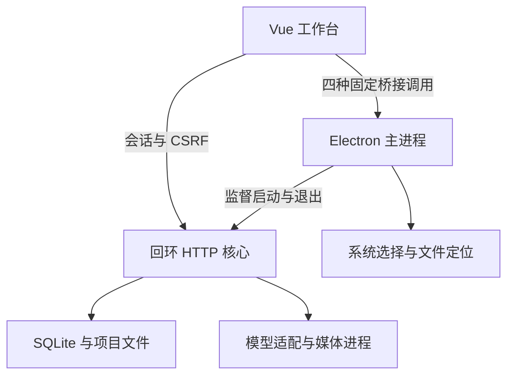

# P5 · 桌面入口与升级保护

## 使用方式

桌面入口复用 P1–P4 的 Vue 界面、本地 HTTP 合同、SQLite、项目文件和任务恢复代码。Electron 主进程只负责窗口、系统文件选择、生命周期和四个有限桥接方法；业务核心在 Electron 自带 Node 的 utility process 中运行。

从源码启动需要 Node 24.12+（24.x）：

```bash
npm ci
npm run desktop
```

生成个人本机使用的 macOS ZIP：

```bash
npm run package:mac
```

产物在 `release/`。默认构建当前架构；可在 macOS 上用 `-- --arm64` 或 `-- --x64` 明确指定。解压后运行 `OwnTake.app`。此流程没有 Apple 签名、公证、商店发布或自动更新；本地构建后的应用内置 Electron / Node，无需额外安装 Node。FFmpeg、字体以及可选 CC / Codex 仍在本机配置，不打入应用。

macOS CI 在包内应用冒烟成功后上传 `OwnTake-mac-<架构>` 构建文件，保留 7 天，可在该次 Actions 运行的 Artifacts 中下载；超过保留期可从源码重新构建。CI 的中文字幕检查使用固定提交与 SHA256 核验的 Noto Sans CJK SC 字体，不依赖 runner 预装的 Apple 字体，该测试字体不进入应用包。

macOS 的带字幕导出需要含 `libass` 的 FFmpeg。当前 Homebrew 的 `ffmpeg-full` 明确包含该库且为 keg-only，可以安装并查出目录：

```bash
brew install ffmpeg-full
brew --prefix ffmpeg-full
```

在 OwnTake 设置中选择此目录下的 `bin/ffmpeg` 和 `bin/ffprobe`，以及包含所需中文字形的字体文件。普通 `ffmpeg` 安装是否含相应过滤器取决于具体构建；工具版本检查通过不等于验证了全部过滤器、编解码器或中文字形。

## 生命周期与共享数据

| 操作 / 情形 | 实际行为 |
| --- | --- |
| 关闭窗口 | 隐藏窗口，本机核心和任务继续；通过应用菜单、托盘、macOS Dock 或再次打开应用恢复窗口 |
| 明确退出应用 | 有未结束任务时说明影响；确认后停止认领、终止自有本地工作、持久化状态，再退出 |
| 已知远端生成 | 保存原任务 ID；下次启动核对原任务，不创建第二次生成 |
| 未知提交 | 保留未知状态及费用预留，不自动重发 POST 或再次启动 CLI |
| 系统休眠 | 本地处理及网络通信可能暂停；唤醒后的超时和恢复沿用核心语义，不承诺后台持续计算 |
| 核心异常退出 | 提示退出并重新启动，不静默重启可能产生费用的进程 |
| 界面进程退出 | 可重新加载界面，核心继续管理任务 |
| 再次打开相同桌面实例 | 聚焦已有窗口；核心数据目录锁仍是 Web / 桌面共享的最终互斥边界 |
| 同一目录已有 Web 服务 | 明确提示先停止原服务，不启动第二个调度器，不杀其他服务进程 |

桌面核心使用随机回环端口，由自己启动的子进程报告地址，不扫描并信任一个碰巧响应的端口。项目目录和应用数据默认位置与 Web 一致；需要隔离时仍使用 `OWNTAKE_DATA_DIR` / `OWNTAKE_PROJECTS_DIR`。不要让两个入口同时占用相同的数据目录。

主实例锁采用完整记录的独占发布；旧锁恢复由专用 guard 串行处理，删除前重新核对 nonce、inode 与 PID。若恰好在恢复临界区被强制终止，可能遗留 `instance-recovery.lock`；应用会阻止未经核实的接管，需要确认所有实例停止后检查锁文件，不能只凭一个 PID 杀掉其他进程。

项目根目录在启动配置中确定；界面可打开现有项目目录和定位成片。原生文件选择用于 FFmpeg、ffprobe、字体和运行时路径，选中仅填表，保存才生效；媒体导入继续使用标准文件选择。没有提供会悄悄移动既有媒体的目录切换。

## 进程与权限边界



- 渲染器启用 `contextIsolation`、`sandbox` 与 `webSecurity`，关闭 Node 集成和 webview，拒绝新窗口及外部导航。
- 预加载只暴露 `info`、`choosePath`、`openProject`、`revealArtifact`；不提供通用 IPC、文件读写、shell 或环境变量接口。
- 每个特权调用同时校验当前窗口身份、主框架身份和精确核心 origin；选择类别只有四个枚举，项目和成片通过资源 ID 交由核心校验后解析。
- 子进程环境按白名单构建，保留必要系统路径、locale、原有认证目录引用与明确数据位置；不复制模型 API Key、注入变量或任意主进程环境。
- macOS PATH 补充常见 Homebrew 目录。显式选择的绝对路径仍是可复核的依据；GUI 不执行用户 shell 初始化脚本。
- 桌面日志位于数据目录下 `desktop/desktop.log`，仅写生命周期事件；不记录供应商正文、prompt、原始 CLI stderr 或认证内容。文件大小在启动时有界轮换。

## 数据库升级前快照

已有旧版数据库升级前，先做 SQLite 一致性快照，再执行原有事务迁移。快照放在应用数据目录的 `backups/migrations/`，包含独立数据库文件和带 SHA256 / 大小 / 原始版本 / 目标版本的清单；发布前验证完整性并同步到磁盘。备份失败会停止升级，迁移失败保留原数据库和已发布快照。

这是 **元数据快照**：会包含数据库中的完整回复 BLOB 和抽帧证据，媒体文件仍留在原项目目录，不包含供应商凭据。迁移到另一台机器、移动项目或清理原媒体之前，应使用 README 中的全量便携备份。系统不会自动拿旧快照覆盖当前作品；恢复前先保留当前数据，再核对原版本和对应媒体。

新库、当前版本和比应用更新的版本不反复创建快照；高版本数据库拒绝降级。有数据结构却没有有效版本标记的数据库拒绝当作新库初始化。快照路径、清单和文件摘要校验拒绝符号链接或被修改的数据。

## 验证记录

本阶段的合入门槛包括服务 / 界面 / 桌面类型检查、全部 Node 测试、生产构建、Linux 原生冒烟，以及 macOS 源码和打包应用的原生冒烟。执行结果以 [P5 PR 的自动检查与记录](https://github.com/h-yu-u/OwnTake/pull/5) 为准，未成功的检查不会视为验收通过。

本地 `npm run check` 已通过：三类 TypeScript 检查、135 项测试、Vue 生产构建和三个桌面入口 bundle。Linux 应用目录打包通过，归档检查只包含应用入口、前端及 package.json，不包含数据库、凭据或 node_modules。

当前本地构建环境为 Linux / Node 24.22.1；Electron 45.2.3 自带 Node 24.22.2，依赖均由 lockfile 锁定。当前受管容器禁止 Electron 单实例功能需要的 AF_UNIX socket，实际桌面启动检查转交 GitHub Linux / macOS runner；没有为通过本机测试删除单实例保护。

可复现的原生冒烟入口为 `npm run smoke:desktop`。它使用临时项目、FFmpeg 合成媒体和真实 Electron，验证导入、导出、有限桥接、隐藏 / 重新打开窗口、正常退出与重启恢复。系统文件对话框及文件管理器调用在测试中被拦截，以确定性地验证取消、选择和解析结果；这不代表人工操作过原生对话框。

只有容器 CI 显式设置 `OWNTAKE_DESKTOP_TEST_NO_SANDBOX=1` 时，测试启动器才使用 `--no-sandbox`。生产入口保持沙盒偏好，macOS CI 不使用该选项；容器检查不被记作操作系统沙盒验收。

真实账号的模型质量、已登录 CC / Codex、用户自己的 macOS 版本 / Keychain / 字体和休眠唤醒，仍需目标机器验收。CI 媒体是合成的确定性样例，不构成模型生成作品。

## 官方依据

- [Electron utilityProcess](https://www.electronjs.org/docs/latest/api/utility-process) · [父进程消息端口](https://www.electronjs.org/docs/latest/api/parent-port)
- [Electron 安全边界](https://www.electronjs.org/docs/latest/tutorial/security) · [上下文隔离](https://www.electronjs.org/docs/latest/tutorial/context-isolation)
- [electron-builder 配置](https://www.electron.build/configuration.html)
- [Homebrew ffmpeg-full](https://formulae.brew.sh/formula/ffmpeg-full)
